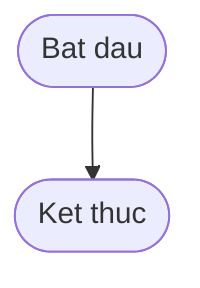

# BÀI TẬP 3 - SESSION 11: PHÂN TÍCH TRADE-OFF FUNCTION DECLARATION VS FUNCTION EXPRESSION VS ARROW FUNCTION

> 👤 **Học viên:** Hoàng Công Dũng | **Mã SV:** PTIT-HCM-009
> 🏫 **Môn học:** it103b-rl-HoangCongDung

---

## 📊 Sơ đồ thiết kế hệ thống (Flowchart)

> 💡 *Sơ đồ dưới đây được render tự động trực tiếp trên GitHub bằng Mermaid. Bạn cũng có thể tải file **`bt3.drawio`** trong repository này để mở và chỉnh sửa trực tiếp trên [Draw.io (diagrams.net)](https://app.diagrams.net).* 

---

## 1. Mục tiêu và Bối cảnh bài toán

Hôm nay ngồi làm bài tập môn Xây dựng ứng dụng web với Javascript, gặp phần phân tích 3 cách khai báo hàm trong JS. Trong quá trình code nhóm, việc các thành viên dùng lẫn lộn Function Declaration, Function Expression và Arrow Function mà không nắm rõ bản chất cơ chế Hoisting hay con trỏ this rất hay gây ra bug khó đỡ. Bài này mình hệ thống lại chi tiết và viết file solution_ex10.js nộp lên tổ chức github it103b-rl-HoangCongDung.

- So sánh chi tiết 3 hình thức khai báo hàm phổ biến trong JavaScript.
- Lập bảng đối chiếu Hoisting, ngữ cảnh con trỏ this và đối tượng arguments.
- Đưa ra quy chuẩn viết hàm tối ưu nhất cho dự án Smart Home IoT.

## 2. Phân tích Chi tiết Trade-off và Cơ chế kỹ thuật

Để hiểu rõ bản chất từng loại hàm, mình đã lập bảng so sánh dựa trên các tiêu chuẩn cốt lõi về kỹ thuật dưới đây:

| Tiêu chuẩn | Function Declaration | Function Expression | Arrow Function (=>) |
| --- | --- | --- | --- |
| Cơ chế Hoisting | Được nâng lên hoàn toàn (gọi trước khi định nghĩa) | Không được nâng (phải định nghĩa trước khi gọi) | Không được nâng (phải định nghĩa trước khi gọi) |
| Cú pháp | Dài, bắt buộc dùng từ khóa function | Gán hàm ẩn danh hoặc có tên vào biến const/let | Ngắn gọn, hỗ trợ implicit return (return ngầm định) |
| Con trỏ this | Động, phụ thuộc vào ngữ cảnh gọi hàm | Động, phụ thuộc vào ngữ cảnh gọi hàm | Kế thừa con trỏ this từ phạm vi bao ngoài (Lexical this) |
| Đối tượng arguments | Có sẵn đối tượng arguments bên trong hàm | Có sẵn đối tượng arguments bên trong hàm | Không có arguments (phải dùng rest parameter ...args) |

## 3. Minh họa Code Hoisting và Thực thi

Dưới đây là phần code thử nghiệm để kiểm chứng hành vi Hoisting của Function Declaration so với Function Expression:

- Function Declaration cho phép gọi hàm trước khi viết câu lệnh định nghĩa ở phía dưới.
- Function Expression nếu gọi trước khi gán giá trị sẽ văng lỗi ReferenceError hoặc TypeError.

## 4. Đề xuất Quy chuẩn Viết hàm cho Dự án Smart Home IoT

Dựa vào các phân tích trade-off trên, mình đề xuất team áp dụng quy chuẩn thống nhất cho toàn bộ mã nguồn dự án Smart Home IoT như sau:

Thứ nhất, ưu tiên sử dụng Arrow Function cho các hàm callback, hàm xử lý sự kiện ngắn hoặc các phương thức trong Array methods (map, filter, reduce) tận dụng tính gọn gàng và Lexical this.

Thứ hai, sử dụng Function Declaration cho các hàm tiện ích toàn cục (global utility functions) cần tận dụng cơ chế Hoisting để gọi linh hoạt ở bất kỳ vị trí nào trong file.

Thứ ba, hạn chế dùng Function Expression trừ khi cần tạo hàm ẩn danh truyền trực tiếp hoặc hàm bám theo điều kiện logic thời gian chạy (runtime).

- Luôn tuân thủ strict mode ('use strict') trong mọi file JS.
- Sử dụng const cho hầu hết các biến gán hàm để tránh việc ghi đè nhầm lẫn.

---

## 📁 Danh sách tệp tin nộp bài trong Repository
- 📝 `bt3.docx`: Báo cáo tài liệu phân tích nghiệp vụ hoàn chỉnh.
- 🎨 `bt3.drawio`: File thiết kế sơ đồ chuẩn theo quy định đề bài (mở trực tiếp bằng [Draw.io](https://app.diagrams.net) hoặc Lucidchart).
- 💻 `solution_ex10.js`: Mã nguồn chương trình.
